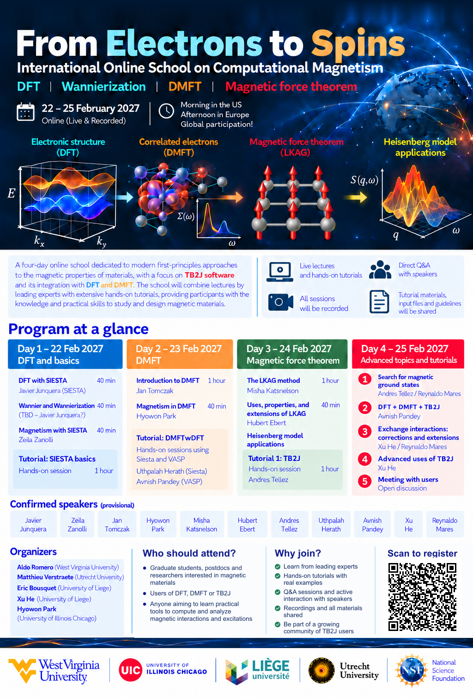

From Electrons to Spins: International Online School on Computational Magnetism
===============================================================================

**22–25 February 2027 · Online**

This four-day school connects electronic-structure calculations to magnetic
interactions and spin models, combining lectures, hands-on tutorials and
discussion. Sessions are planned for the morning in the US and afternoon in
Europe. Participants from around the world are welcome. The program and
session times are tentative.

`Register for the school <https://forms.cloud.microsoft/Pages/ResponsePage.aspx?id=hDvhYmAZYkWMf3JHKVHaj-4EL_rMTTNOvLKEQmTYvCpURURIMUNPOVo1WTRTWlRXNVEzSU8yMEhKTy4u&lang=en-US>`_

Tentative program
-----------------

* **22 February — DFT and basics:** SIESTA, Wannierization, magnetism and a SIESTA tutorial.
* **23 February — DMFT:** introduction, magnetism in DMFT and a DMFTwDFT tutorial.
* **24 February — Magnetic force theorem:** LKAG, its uses and extensions, Heisenberg model applications and a TB2J tutorial.
* **25 February — Advanced topics:** magnetic ground states, DFT+DMFT+TB2J, exchange interactions and extensions, advanced uses of TB2J and discussion.

Organizers: Aldo Romero, Matthieu Verstraete, Eric Bousquet, Xu He and Hyowon Park.

